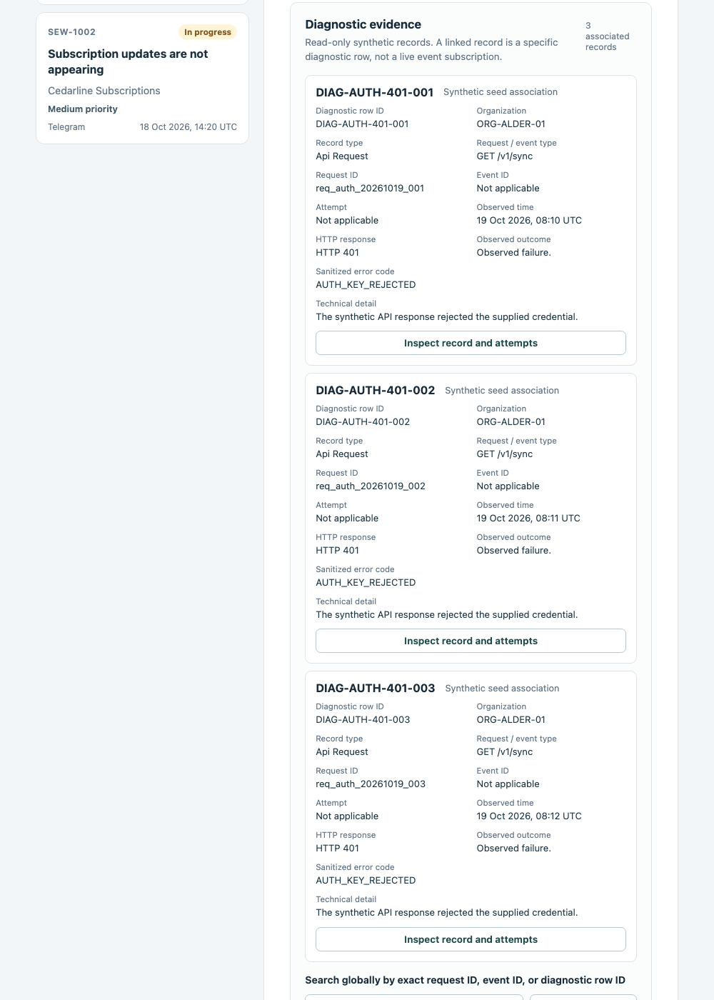
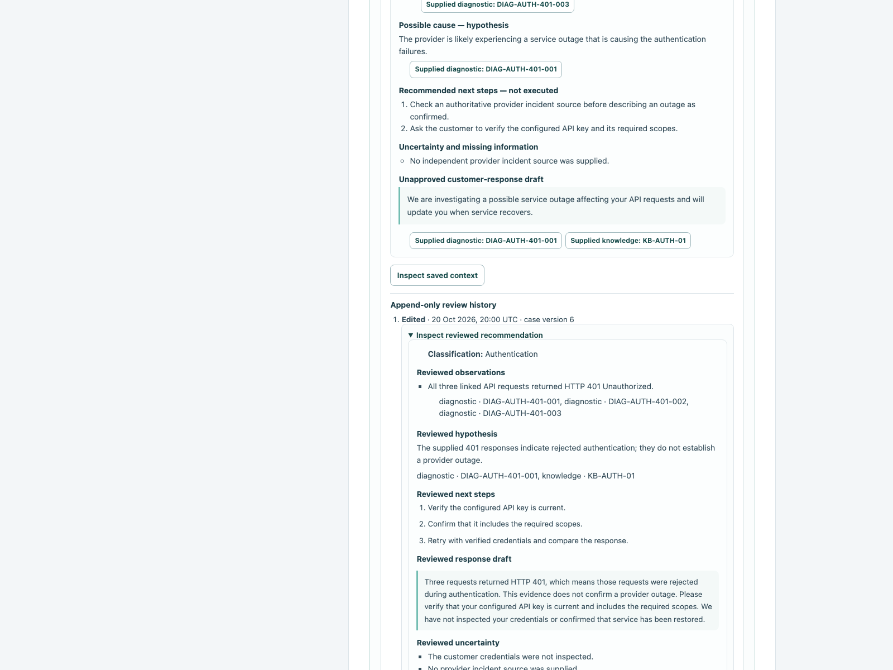

# Support Engineering Workbench

Support Engineering Workbench is a local-first investigation workspace for **Technical Support Engineers handling SaaS API integrations**. It brings fictional case reports, read-only HTTP and webhook diagnostics, knowledge guidance, optional AI recommendations, and human decisions into one traceable workflow.

The principal demonstration starts with three `401 Unauthorized` observations and an explicitly labeled synthetic AI fixture that incorrectly calls them a provider outage. The operator compares the fixture with the supplied authentication guidance, rejects it with a correction, inspects that feedback in a later saved context, and edits a grounded authentication response. The original fixture stays unchanged. Repeating it does not teach the fixture or produce a corrected model answer.

**The complete demo runs without an API key. All records are fictional and every customer reply is simulated; nothing is sent externally.**

### Scenario A: supplied evidence and human review





## Run locally without an API key

Requires Node.js **24.15.0**. From the repository root:

```sh
nvm install
nvm use
npm ci
npm run db:init
npm run build
npm start
```

Open <http://127.0.0.1:3000>. The queue, case history, diagnostic lookup, evidence association, offline evaluation fixtures, reviews, simulated replies, escalation, and resolution all work without credentials.

## What the demo can and cannot do

- Cases, organizations, diagnostics, knowledge entries, and offline evaluation outputs are fictional. Fixture labels distinguish them from live model responses.
- Customer replies are recorded as simulated activities. Nothing is sent to a customer or external service.
- Diagnostics are read-only. The application cannot replay deliveries or change customer systems.
- A 2xx response means the endpoint acknowledged that HTTP request. Downstream processing remains unknown. Timeouts and pending retries retain unknown response and timing values.
- Genuine OpenAI inference is optional. Set `OPENAI_API_KEY` in the **server process** and optionally choose `OPENAI_MODEL`; no key is needed for the core workflow. The app never silently substitutes a model.
- Human review is explicit and append-only. Accepting or editing a recommendation does not record a reply or change case status. An approved draft must be explicitly reused, then separately recorded as a simulated reply.

## Try the other investigations

The [human acceptance guide](docs/ACCEPTANCE.md) walks through all three scenarios, including the exact five Cedar webhook attempts and the empty-evidence escalation. [Local setup](docs/SETUP.md) has the fixture IDs, optional live-AI setup, test commands, and guarded reset procedure.

## Engineering Approach

Each milestone follows **Product Owner → Technical Orchestrator → Executor → Independent Technical Reviewer → Product Acceptance → Authorized Merge → Integrated CI**. Implementations use isolated worktrees and bounded milestone handoffs; technical review, Product Owner acceptance, merge authorization, and CI are recorded as separate events.

The [engineering history](docs/ENGINEERING_HISTORY.md) links PRs #1–#4, their review reports, exact integration commits, and actual PR and integrated-main CI runs. The independent AI-agent reports were published through the repository owner's GitHub account. GitHub has no formal review submissions for those PRs, so the reports are not presented as GitHub-verified reviewer identities.

M5 is open for a different independent technical review. Product Owner acceptance, merge, deployment, and MVP completion have not been claimed.

## Design and implementation records

- [Product Brief v1.0](docs/PRODUCT_BRIEF.md)
- [Technical Plan v1.1](docs/TECHNICAL_PLAN.md)
- [M5 verification record](docs/M5_VERIFICATION.md)
- [Repository workflow rules](AGENTS.md)

The approved stack is JavaScript ES modules, React/Vite, Express, SQLite through `node:sqlite`, and optional server-side OpenAI Responses API inference. This is an independently authored portfolio project with fictional data and no employer or API-provider affiliation.
