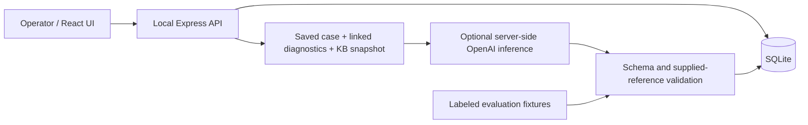

# Support Engineering Workbench — Technical Plan v1.1

**Approved baseline.** On 2026-10-20 the Product Owner stated: “Product Owner Decision: Technical Plan v1.1 APPROVED” and approved [Product Brief v1.0](PRODUCT_BRIEF.md) together with this plan as the implementation baseline.

This document consolidates the accepted v1.0 technical decisions with the approved v1.1 changes. It records an actual human planning decision, not implementation, reviewer, CI, live inference, or product acceptance evidence. The current bootstrap assignment is repository/document preparation and an M1 handoff; application work has not started.

## 1. Changes from v1.0

- Reduce M1 to a working foundation, initial synthetic case data, minimum durable state, transaction/idempotency infrastructure, tests, and CI.
- Introduce diagnostic/association/KB tables in M3 and analysis/review tables in M4 through incremental migrations.
- Require M5 to deliver an actual running-application screenshot, a product-first README, verified local setup, an Engineering Approach section, and honest PR/CI/product-decision references.
- Explicitly validate the pinned Node runtime and `node:sqlite` persistence. Make the model configurable server-side and require a genuine successful request before claiming live inference validation.
- Preserve the accepted architecture, all three scenarios, business rules, human approval, reference validation, immutable history, and safe no-key operation. Do not preimplement M2–M4.

## 2. Requirements interpretation and scope

The product is an investigation workbench: review case context, inspect diagnostics, review AI recommendations, and record a human decision and outcome. It is not a general-purpose helpdesk.

No contradiction blocks the plan. The approved implementation defaults are:

| Question | Decision |
| --- | --- |
| Is a case-creation form required? | No. Seeded cases demonstrate simulated email, Telegram, and manual intake. |
| Can resolved cases reopen? | No status reopening in v1; later notes/reviews remain appendable. |
| Can status changes bypass outcomes? | No. Escalation requires context; resolution requires an outcome. |
| What does accepting AI mean? | A recorded operator review. It does not send a message or change case status. |
| Does a valid reference verify a claim? | It confirms supplied-source membership, not factual correctness. |
| Can all scenarios run without a key? | Yes, through three explicitly labeled evaluation fixtures, including the intentionally incorrect A fixture. Genuine inference is a separate action. |
| Does public source require a writable public service? | No. Publish source and synthetic fixtures; run locally on loopback without production authentication or hosting. |

The principal journey is queue → case → diagnostic search/association → analysis or fixture → explicit review → simulated reply → resolution or escalation. It must also remain usable manually without AI.

## 3. Architecture and tradeoffs

| Area | Approved choice | Reason |
| --- | --- | --- |
| Language/runtime | JavaScript ES modules, Node.js 24.15.0 baseline, npm lockfile | Fits the stated JavaScript experience; pin and validate the runtime in M1 and CI. |
| Frontend | React, Vite, plain CSS, component state, native fetch | Supports the interactive journey without a routing/state-management platform. |
| Backend | Express; same-origin JSON API serving the built frontend | One local application and one credential boundary. |
| Persistence | SQLite through built-in `node:sqlite` | Durable transactions without a database service, ORM, or native npm database addon. |
| Validation | Zod | Runtime request validation and one structured analysis contract. |
| AI | OpenAI Responses API through the official JavaScript SDK | One bounded integration with deterministic injected provider doubles for tests. |
| Model | Proposed default `gpt-5.6-terra`; server-side `OPENAI_MODEL` override | Record the actual returned model for each live analysis. Account access and quality remain unvalidated until exercised. |
| Tests | `node:test`, temporary on-disk SQLite databases, Playwright/Chromium | Real transaction/restart coverage plus principal browser journeys without paid CI calls. |
| Delivery | Local execution; genuine GitHub Actions checks | No mandatory cloud infrastructure. |

Node 24.15.0 documents `node:sqlite` as **release candidate**, not fully stable. This is an accepted dependency-reduction tradeoff, subject to M1 runtime/persistence verification. Keep synchronous database transactions short and never await a network call inside one. A significant compatibility blocker must go to the Product Owner rather than silently changing the design. See [versioned Node documentation](https://nodejs.org/download/release/v24.15.0/docs/api/sqlite.html).

Vite's JavaScript React template and the proposed runtime are documented in [Vite's guide](https://vite.dev/guide/). Concrete dependency versions must be locked and tested in M1. The proposed model documents Responses and Structured Outputs support in its [official model documentation](https://developers.openai.com/api/docs/models/gpt-5.6-terra); that does not constitute a configured-provider test.

Use one package and lockfile with `client/`, `server/`, `shared/`, `db/`, `fixtures/`, `scripts/`, `tests/`, `e2e/`, `docs/`, and `.github/workflows/` as functionality requires them. The shared module contains the analysis schema, never credentials or server configuration. Do not create empty future modules during bootstrap or M1.

Keep concrete modules and a small injected provider function for tests. Do not add Redux, an ORM, vector search, agent frameworks, distributed queues, production authentication, provider abstraction hierarchies, streaming, container requirements, hosting, or external ticketing integrations. Do not copy GhostPilot's source, documentation, credentials, workflows, prompts, infrastructure, or business-specific implementation details.

## 4. Screens and demonstration workflows

The final interface needs a queue; a case workspace with report, history, evidence, AI/review cards and outcome forms; global diagnostic search; and a compact review-quality view. KB entries open from evidence references. Use hash navigation for refresh/back links without a router dependency. No decorative screens or unrelated dashboard.

Preserve form text on errors and conflicts. Load committed state after successful writes; do not imply a failed save succeeded. Disable pending submission buttons while retaining backend correctness checks. Use accessible labels, keyboard operation, and textual outcomes alongside color.

Reply actions must say **Record simulated reply**. An accepted draft remains separate from a recorded message. An explicit **Use reviewed draft** action copies it into the composer, followed by a separate operator action to record it. No real send operation exists.

| Scenario | Required journey and synthetic data |
| --- | --- |
| A — authentication | `SEW-1001`, fictional email case. Inspect three linked 401 responses; explicitly load the intentionally wrong outage fixture; inspect its valid references but incorrect conclusion; reject and record the authentication correction; prepare a simulated reply; resolve with an outcome. |
| B — webhooks | `SEW-1002`, fictional Telegram case. Search initially unlinked evidence. One event has 500, timeout/no response, then 204 acknowledgment; another has 503 then pending. Inspect all attempts, associate evidence, review a labeled fixture or live analysis, explain observed outcomes, and escalate remaining uncertainty. |
| C — insufficient evidence | `SEW-1003`, fictional manual case. No reliable request/event ID, occurrence window, or matching diagnostics. Review explicit uncertainty, request identifiers/UTC time window/environment/sanitized errors through a simulated reply, or escalate with an empty evidence list. |

Use stable fictional identifiers and fixed UTC fixture timestamps. Initial cases cover all three channels and more than one status. M1 seeds cases and initial reports only; M3 introduces technical/KB fixtures; M4 introduces evaluation outputs. A separate unrelated-organization diagnostic row in M3 tests global discovery and rejected cross-organization association.

Four small KB entries cover authentication, webhook retry/acknowledgment semantics, request identifiers/time windows, and outage-evidence limits. Sending all four entries is sufficient; no retrieval platform is needed. Fixture output has an explicit source label and no fabricated provider/model metadata. Never preload operator reviews.

## 5. Incremental persistence and domain model

| Milestone | Schema introduced |
| --- | --- |
| M1 | `cases`, `activities`, `mutation_receipts`, with fields needed for initial cases/reports, versions, and durable mutation infrastructure. |
| M2 | Constraints/indexes required by implemented manual workflows; no speculative tables. |
| M3 | `diagnostics`, `case_evidence`, `knowledge_entries`. |
| M4 | `analyses`, `reviews`. |
| M5 | No planned schema expansion; only concrete defect repairs if needed. |

Domain ownership when introduced:

- **Case:** stable ID, organization ID/name, subject, description, channel, priority, status, timestamps, integer version. Read seeded priorities; priority administration is outside scope.
- **Activity:** append-only sequence, case ID, timestamp, action type, structured payload. Stores reports, notes, simulated replies, transitions, escalations, resolutions, and evidence/review/analysis-lifecycle references. No second message/outcome table is needed.
- **Mutation receipt:** unique request key, deterministic method/route/payload fingerprint, committed response. Retain until an explicit demo reset.
- **Diagnostic row:** immutable ID, organization, request/event IDs, type, timestamp, outcome, nullable HTTP status/attempt number, sanitized error. Each webhook attempt is a row sharing its event ID.
- **Case evidence:** unique case/diagnostic-row association. Linking never changes diagnostic rows.
- **KB entry:** fixed ID/version/title/fictional content; no editor.
- **Analysis:** source, lifecycle status, exact supplied-context snapshot, captured case version, prompt/schema versions, provider/returned model where applicable, original output, reference-validation report, safe failure code. Terminal output is immutable.
- **Review:** append-only decision/time, reviewed content, rejection reason/correction. Further decisions append records and preserve previous ones.

Use foreign keys, bound SQL parameters, enum constraints, numbered migrations, UTC timestamps, and activity sequence ordering. Case changes, related records, activity, version increments, and receipts commit in one transaction. Errors roll back the complete mutation.

Initial seeding runs only against an empty application database. Startup and repeat initialization must not replace operator data. Migrations preserve earlier records. Demo reset is an explicit CLI command with `--confirm`, restricted to the recognized project demo database while the server is stopped. Refuse an unrelated/custom path; document data loss. There is no HTTP reset route. Tests use isolated temporary paths.

Essential persistence checks: normal server stop/start preserves case/activity/version/receipts; injected failure leaves no partial mutation; receipt replay still works after restart; repeated initialization is non-destructive; later migrations retain earlier case/history data; reset confirmation/path protection work. M1 must validate the pinned Node runtime and SQLite behavior rather than assuming compatibility.

### Case transitions, implemented in M2

| Current | Allowed next states |
| --- | --- |
| Open | In progress, Escalated, Resolved |
| In progress | Escalated, Resolved |
| Escalated | In progress, Resolved |
| Resolved | None |

Current-state requests are no-ops. Escalation requires reason, current findings, outstanding questions, and an evidence list; empty questions/evidence are allowed when appropriate. Evidence IDs must already be linked to the case. Resolution requires a nonblank outcome. Save outcome records and transitions atomically. Re-entering Escalated creates a new historical record. Later notes/reviews on resolved cases preserve their terminal state and original outcome.

### Diagnostic correlation, implemented in M3

Search globally by exact trimmed request ID, event ID, or diagnostic-row ID, including unlinked evidence. Missing matches are an empty result, not an inferred failure. Order webhook attempts by attempt number/time and show each observed outcome. A 2xx confirms endpoint acknowledgment, not downstream business processing. Pending attempts have no invented response or delivery time.

Evidence association validates every ID and organization before writing; reject unknown/mismatched rows without partial links. Unique pairs make repeated links no-ops. Related attempt-row IDs may be linked atomically. Inspection cannot mutate diagnostics or trigger replay.

## 6. API and idempotency contract

Implement routes only in their owning milestone. All case-changing requests require an idempotency key and expected case version.

| Endpoint | Purpose / milestone |
| --- | --- |
| `GET /api/config` | Safe availability/configuration metadata; never secret values. M1 foundation. |
| `GET /api/cases` | Minimal seeded read data in M1; complete queue/status filtering in M2. |
| `GET /api/cases/:id` | Case/history/evidence/analyses/reviews as introduced, starting M2. |
| `POST /api/cases/:id/activities` | Note or simulated reply. M2. |
| `PATCH /api/cases/:id/status` | Validated transition with required outcome/context. M2. |
| `GET /api/diagnostics?q=…` | Global lookup and related attempts. M3. |
| `POST /api/cases/:id/evidence` | Atomic association of existing rows. M3. |
| `GET /api/knowledge/:id` | Read-only KB inspection. M3. |
| `POST /api/cases/:id/analyses` | Request live inference or explicitly load a fixture. M4. |
| `GET /api/analyses/:id` | Lifecycle, original output, supplied context. M4. |
| `POST /api/cases/:id/analyses/:analysisId/reviews` | Append accept/edit/reject. M4. |
| `GET /api/reviews` | History and demonstration totals. M4. |

No diagnostic mutation, delivery replay, or external messaging endpoints. In M1 the transaction mechanism is tested directly, without operator mutation or test-only HTTP write endpoints.

### AC-13: one server process, one database, multiple tabs

1. The browser creates a UUID per submission and retains it with the exact payload for double-clicks/network retries. Pending submission metadata survives reload in session storage.
2. Validate input and fingerprint method, route, and canonical validated payload, including `expectedVersion`.
3. Inside a short write transaction, check receipts before checking current case version. Same key/payload replays the committed response even after later case changes. Changed payload under that key returns `409 idempotency_key_reused`.
4. New keys with a stale version return `409 stale_case` without mutation. Do not silently replay a changed action against refreshed state.
5. Commit mutation, activity, version, and receipt together; report success only after commit. Identical-state/already-linked requests produce a receipt but no duplicate activity or version increment.
6. Conflicts preserve drafts for refresh/reconciliation. Validation/storage/busy errors do not leave partial state or report success.

Two distinct concurrent mutations at version N produce one commit and one conflict. Identical text with a new key and refreshed version is a new intentional note, not semantically deduplicated content. Receipts are durable across normal restarts.

### Live analysis lifecycle, implemented in M4

Commit a durable `running` analysis with context snapshot, activity, and keyed receipt before inference. Return `202` with its ID. Duplicate keys return that acknowledgment without redispatch. One running live analysis per case is enforced in the database; a different key while running returns `409 analysis_in_progress`.

Start one bounded in-process provider request after commit, outside any SQL transaction. The UI polls only while waiting. Completion/failure updates the analysis and history atomically without erasing earlier records. Display snapshot time/captured case version and inspectable supplied context; do not imply later notes were included.

At startup mark leftover running analyses `interrupted` with activity before accepting requests. Never resend automatically. A deliberate retry creates a new analysis/key. A crashed process cannot guarantee exactly-once remote inference or billing; the contract guarantees no duplicate local record or automatic redispatch.

## 7. AI contract, review, and quality evaluation

Construct context server-side from case/report, conversation, corrective review feedback, linked diagnostics, and all four fixed KB entries. Exclude unrelated cases and unlinked events. Save exactly the supplied context. Reject oversized input explicitly instead of implying omitted data was inspected.

Treat case/diagnostic text as untrusted data, not privileged instructions. Configure no tools, web search, URL fetching, or actions. Keep the key and `OPENAI_MODEL` server-side. Proposed bounds remain 64 KiB mutation bodies, 10,000 characters per note/reply, 100 KiB AI context, 4,096 output tokens, 60-second timeout, and SDK automatic retries disabled.

Use Responses strict Structured Outputs from the shared Zod contract with `store: false`. Refusal, incomplete output, malformed content, and provider errors become explicit failures. Structured output does not establish truth. See [Structured Outputs](https://developers.openai.com/api/docs/guides/structured-outputs) and [Responses storage configuration](https://developers.openai.com/api/docs/guides/migrate-to-responses).

| Output | Contract |
| --- | --- |
| Classification | Suspected category: authentication, webhook delivery, insufficient evidence, or other. |
| Observations | Text with supplied evidence references; empty when no supported observation exists. |
| Possible cause | Explicit hypothesis or null. |
| Next steps | Nonempty concrete diagnostic/corrective suggestions; never executed. |
| Draft response | Customer-readable text, unapproved until review. |
| References | Typed diagnostic/KB IDs, including references nested in observations/hypothesis. |
| Uncertainty | Missing information/limits; nonempty for insufficient evidence. |

Check every structured reference against the saved supplied-context allowlist, not the entire database. A real-but-unsupplied ID is unsupported. Preserve flagged output with no trusted source link/badge; quarantine it and block approval/edit-as-approved/draft reuse, while allowing rejection and correction. A new generation or manual reply can continue the workflow.

Render **AI-proposed — human verification required** observations separately from diagnostic facts. Reference checks never mark claims factually verified. Valid citations can accompany a wrong conclusion, as scenario A demonstrates.

- **Accept:** append reviewed content and decision; no reply or status change.
- **Edit and approve:** append a complete reviewed version; preserve original output and earlier decisions. Validate edited structured references against the same supplied context.
- **Reject:** require a nonblank reason or correction; preserve original output and full history.
- **Reanalyze:** create a new snapshot/analysis after added context or corrective feedback.

The case version prevents stale competing decisions. Show latest decision plus full history. Count distinct reviewed analyses by latest decision so accepted + edited + rejected = reviewed. Keep fixture/live totals separate, show rejection reasons and links, and label all metrics synthetic demonstration data. Fixture results are not live-model accuracy evidence.

The quality rubric checks evidence interpretation, supplied references, uncertainty, useful next steps, understandable drafts, and absence of automatic action. A must not infer a confirmed outage from 401s; B must distinguish acknowledgment from processing and unresolved delivery; C must ask for specific missing information without inventing a cause. CI uses deterministic valid, missing-evidence, malformed, refusal, timeout, and unsupported-reference doubles. Separately record genuine configured inference results with actual model, prompt version, timestamp, and rubric outcomes. Do not claim live validation until a real configured request succeeds.

## 8. Five sequential milestones

Each executor implements one bounded task in an isolated branch/worktree. A different reviewer independently inspects it. Relevant checks and review findings are resolved before integration and the next milestone. Genuine PRs, exact commits, review decisions, CI runs, and product decisions form the evidence; none are invented or reconstructed.

### M1 — Working foundation

**Scope/deliverables:** one package/lockfile; pinned runtime; React/Vite shell connected to minimal read-only case data; Express; cases/initial reports for all three fictional intake channels; only `cases`, `activities`, `mutation_receipts`; versioned migrations, initialization/reset, atomic transaction/idempotency helper; tests, PR CI, working setup documentation.

**Dependencies:** approved committed/published baseline and explicit M1 assignment. Validate runtime/SQLite compatibility during M1; escalate a significant blocker to the Product Owner.

**Acceptance/tests:** install/build/start work; fixtures are consistent; seeding runs once; normal restart preserves durable records; injected failure rolls back; committed receipts replay after restart; key collisions/stale versions fail; repeated initialization preserves data; safe reset cannot target unrelated data. Test the mutation infrastructure directly using temporary SQLite files without future-feature HTTP endpoints.

**Review risks:** destructive reset paths, incorrect transaction/receipt ordering, fake persistence tests, and premature domain expansion. **Exclusions:** operator mutation workflows, diagnostic/association/KB tables and fixtures, analysis/review tables or placeholders, provider calls, external messaging, replay, authentication, deployment, and M2–M4 functionality.

### M2 — Manual support workflow

**Depends on M1. Scope/deliverables:** full queue/filter/detail, notes, simulated replies, transitions, escalation/resolution, conflict/error feedback, required constraints/indexes, manual-workflow documentation.

**Acceptance/tests:** AC-01/02/03/10/11 and manual AC-12 through real HTTP/UI; restart persistence; duplicate/stale submissions; invalid transitions/missing outcomes; failed saves preserve drafts and prior data. Apply the approved transaction contract to real operator endpoints.

**Review risks:** validation bypasses, partial writes, misleading success, real-message implications. **Exclusions:** diagnostic/KB schema and investigation, AI functionality.

### M3 — Diagnostic investigation

**Depends on M2. Scope/deliverables:** diagnostic/association/KB migrations and synthetic fixtures; global lookup, ordered attempts, evidence linking, KB inspection, B guide.

**Acceptance/tests:** AC-04/05; unlinked/missing lookup; same-organization correlation; atomic association/no-op duplicates; immutable diagnostics; acknowledgment versus processing; new migration preserves earlier cases/history.

**Review risks:** wrong correlation and overstated delivery outcomes. **Exclusions:** replay, diagnostic editing, ingestion, analysis/review schema and inference.

### M4 — AI and human review

**Depends on M3. Scope/deliverables:** analysis/review migrations; configurable genuine inference; saved context/lifecycle; strict output and supplied-reference validation; three labeled fixtures; immutable originals/append-only reviews; explicit draft reuse; compact totals.

**Acceptance/tests:** AC-06/07/08/09/12 with deterministic tests and visible flows; separately successful genuine request for live AC-06; no-key fixture/manual operation; unsupported IDs; immutable history; duplicate generation/reviews; interruption/refusal/timeout/malformed output; no secrets in client assets/logs; migrations preserve prior records. Without a real request, report live validation pending.

**Review risks:** false factual verification, lost history, duplicate dispatch, mislabeled fixtures, secret exposure. **Exclusions:** agents/tools, autonomous actions, vector retrieval, provider platform, external communication.

### M5 — Acceptance and portfolio presentation

**Depends on M4. Scope/deliverables:** A/B/C browser journeys and concrete fixes; verified clean-checkout setup/reset/no-key guide and separate optional AI setup; actual application screenshot; product-first README; Engineering Approach; genuine review, CI, and human-decision references.

**Acceptance/tests:** AC-13/14/15 and all three scenarios; browser accept/edit/reject, evidence association, simulated reply, escalation/resolution, refresh/restart; production build and integration tests; real PR CI and passing CI on the integrated revision; separately recorded genuine inference; Product Owner principal-journey acceptance.

**Presentation acceptance:** capture the screenshot from the actual running application with meaningful investigation/evidence/review state. A generated image or mockup does not qualify. Within its first screen, the README explains what the product does, who uses it, the principal investigation scenario, and synthetic/simulated boundaries. Include a concise Engineering Approach describing the actual Product Owner → Orchestrator → Executor → Independent Reviewer → Acceptance workflow. Link real PRs, exact CI results/revisions, and actual human product decisions; explicitly label missing evidence. Verify first-screen clarity and screenshot meaning manually, not just file existence.

**Review risks:** attractive but unreproducible behavior, stale documentation, fabricated evidence. **Exclusions:** hosting requirements, new feature areas, decorative dashboards, reconstructed development history.

## 9. Acceptance traceability

Integration means real HTTP/database behavior; browser means visible end-to-end behavior. Unit tests alone do not establish persistence, concurrency, correlation, or product acceptance.

| AC | Owner/component | Automated verification | Manual acceptance |
| --- | --- | --- | --- |
| AC-01 | M2 queue | Integration/browser seeded fields/order | Open queue. |
| AC-02 | M2 filter/detail | Correct case/history | Filter and inspect. |
| AC-03 | M2 transitions, M1 mechanics | Atomic status/activity/version and restart | Change status and restart. |
| AC-04 | M3 search/schema | Request/event/row IDs, unlinked/missing lookup | Find known ID. |
| AC-05 | M3 attempt history | Complete ordered observed outcomes | Interpret B attempts. |
| AC-06 | M4 context/provider/schema | Unit/integration doubles | Genuine configured inference; doubles/fixtures do not satisfy live evidence. |
| AC-07 | M4 references | Unknown and real-but-unsupplied IDs | Inspect sources/warnings. |
| AC-08 | M4 rejection/history | Wrong fixture and correction persist | Reject A. |
| AC-09 | M4 accept/edit | Immutable original, reviewed copy, no auto reply | Approve/edit without recording a message. |
| AC-10 | M2/M3 escalation | Required context/evidence and atomic status | Escalate B/C. |
| AC-11 | M2 resolution | Required outcome and history survive restart | Resolve A. |
| AC-12 | M2/M4 no-key mode | Manual features, fixtures, truthful availability | Run without credentials. |
| AC-13 | M1 infrastructure; M2–M4 endpoints | Temporary-file helper tests in M1; HTTP duplicate/collision/stale/rollback/restart and AI lifecycle as introduced | Repeat submissions and inspect conflict feedback. |
| AC-14 | M2/M4/M5 errors | Storage/HTTP/provider failures retain data/drafts | Observe meaningful failure. |
| AC-15 | M5 setup/journeys | Isolated A/B/C browser runs | Verified clean-checkout README walkthrough. |

BR-01/09 approval/simulation: M2/M4. BR-02/03 evidence/hypotheses/references: M3/M4. BR-04/05/10 immutable history/consistency: M1/M2/M4. BR-06 read-only diagnostics: M3. BR-07 synthetic safe data: every task. BR-08 manual fallback: M2/M4/M5.

NFR-01/02 setup/reset: M1/M5. NFR-03 tests: each milestone, including incremental migration preservation. NFR-04: real PR checks from M1 and passing integrated-revision CI for completion. NFR-05 server-side secrets: M4, with safe foundation configuration from M1. NFR-06 scope: every review. NFR-07 truthful limitations/presentation: every documentation update and M5 screenshot/product-first README/Engineering Approach.

## 10. Local setup, CI, and trust boundaries

Planned commands must be implemented and verified before documentation claims they work: `npm ci`, `npm run db:init`, `npm run build`, `npm start`, `npm test`, `npm run test:e2e`, and `npm run demo:reset -- --confirm`. Do not add E2E placeholders during M1; browser tests arrive with their functionality. Development may use separate server/client commands with an explicit Vite API proxy rather than a process-manager dependency.

Run the built UI/API on loopback. Validate Host and mutation Origin against configured local origins, require JSON state changes, and avoid permissive CORS. Keep production authentication outside scope; this is not an approved writable internet service.

Use ignored server environment configuration; examples contain placeholders only. Never put credentials in client-exposed environment prefixes or logs. Ignore local databases/journals, credentials, generated assets, and test artifacts when those files become relevant in M1. Render operator/model text without raw HTML. Log allowlisted safe error codes/correlation IDs instead of provider bodies, prompts, headers, or whole exceptions. Never fetch customer-provided URLs or expose diagnostic credentials.

GitHub Actions runs deterministic tests and production build on PRs, adds locked Chromium/browser journeys when implemented, and checks integrated main revisions. CI has no paid model dependency. Record exact commits and real run URLs. A workflow file alone is not a passing CI result; do not use decorative badges or unobserved success claims.

## 11. Risk review and completion

| Risk | Proportionate mitigation |
| --- | --- |
| Wrong AI conclusions despite valid citations | Separate facts/hypotheses, human review, intentional A fixture, clear validation limits. |
| Incorrect event correlation | Stable IDs, organization checks, explicit association, complete attempts, negative integration tests. |
| Overwritten output/reviews | Immutable terminal output, append-only decisions/activity, repeat-review and restart tests. |
| Duplicate/conflicting writes | Durable receipts, versions, atomic transactions, explicit AI interruption semantics. |
| Secret leakage | Server-only configuration, ignored files, allowlisted logging, bundle/error-path inspection. |
| Scope growth | Five bounded milestones and explicit exclusions; significant changes require a product decision. |
| Difficult setup or misleading portfolio | Clean-checkout verification, deterministic reset/fixtures, actual screenshot, real PR/CI/review evidence. |
| Runtime/SQLite compatibility | Pin/validate the baseline and essential persistence checks; escalate a significant blocker. |
| Fixture results mistaken for model quality | Persistent source labels, separate totals, separately observed genuine inference. |

Completion requires all three scenarios, every acceptance criterion checked, important business-rule tests, passing CI on the integrated revision, reproducible README setup, at least one genuine configured inference, useful no-key operation, safe publication content, preserved AI corrections, and Product Owner approval of the principal journey. Technical/reviewer approval is not product acceptance.

## 12. Approved M1 executor prompt

Use this prompt with the published bootstrap SHA and explicit M1 assignment. Preparing this handoff does not dispatch an executor or claim implementation/review approval.

> Implement M1 only after Product Owner approval of Technical Plan v1.1.
>
> Work in an isolated branch/worktree from the supplied approved base SHA. If no base commit exists, report the bootstrap dependency before starting.
>
> Retain JavaScript ES modules, pinned Node baseline, React/Vite, Express, SQLite through `node:sqlite`, and one npm lockfile.
>
> Deliver a working application shell connected to minimal read-only case data. Seed three fictional cases covering email, Telegram, and manual intake, with initial reports and stable identifiers.
>
> Create only `cases`, `activities`, and `mutation_receipts`, with the fields needed now. Do not create diagnostic, association, KB, analysis, or review tables, placeholder implementations, or future migrations.
>
> Implement non-destructive initialization, versioned migrations, and an explicit demo-only reset with confirmation and path protection.
>
> Implement the approved atomic transaction/idempotency infrastructure. Test it directly using temporary SQLite databases; do not add test-only HTTP mutation endpoints or prematurely implement operator workflows.
>
> Verify normal restart persistence, rollback after injected failure, durable receipt replay, key/payload collision, stale versions, repeated initialization, and reset safeguards. Validate the pinned runtime and `node:sqlite` compatibility; escalate a significant architectural blocker for Product Owner review rather than silently changing the design.
>
> Add PR CI for deterministic tests and a production build. Document commands that actually work and acknowledge the SQLite API's release-candidate status.
>
> Exclude case-management mutations, diagnostics, KB functionality, AI integration, reviews, messaging, replay, authentication, and deployment. Author all project files independently; do not copy GhostPilot material.
>
> Return the exact commit, implemented scope, executed checks/results, genuine PR/CI links where available, and known limitations. Obtain independent review from a different reviewer; do not claim product acceptance.
