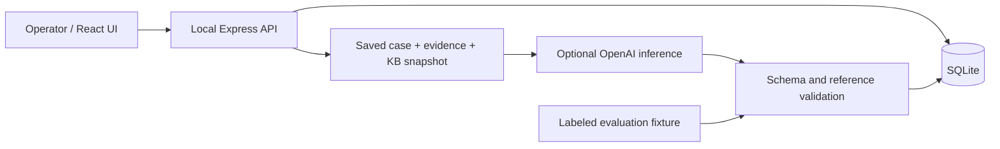

# Technical Planning Package v1.0 — SUPERSEDED

> Historical record of the original orchestrator proposal. **Not authoritative for implementation.** Use [`../TECHNICAL_PLAN.md`](../TECHNICAL_PLAN.md), approved v1.1, for milestone scope and executor instructions. In particular, the original M1 roadmap and M1 executor handoff below are superseded.

---

I recommend **one local JavaScript application: React/Vite, Express, SQLite, and an optional server-side AI connection**. Five sequential milestones can cover the MVP without introducing cloud infrastructure, a retrieval platform, or a general helpdesk system.

This is a proposed planning package for Product Owner review. Implementation remains gated on approval. The workspace has been restored to its original clean state.

**A. Requirements review**

The product is an investigation workbench: collect case context, inspect diagnostic evidence, review AI suggestions, and record a human decision and outcome.

I found no contradiction that blocks technical planning. These details need explicit implementation defaults:

| Ambiguity | Proposed default |
|---|---|
| Must operators create cases? | Seeded cases demonstrate intake. No case-creation form in v1. |
| Which status transitions are allowed? | Use the transition table below; Resolved is terminal. |
| Can status changes bypass outcome capture? | No. Escalation requires context; resolution requires an outcome. |
| Does accepting AI approve a customer message? | It approves the recommendation only. Recording a simulated reply remains separate. |
| Does a valid evidence reference verify a claim? | It confirms that the referenced source was supplied. It cannot establish factual correctness. |
| How do all scenarios remain reproducible without credentials? | Supply three labeled evaluation fixtures, including the intentionally incorrect outage diagnosis. |
| Does “public project” require a publicly writable application? | No. Publish source; run the unauthenticated application locally. |

These are proposed clarifications, not changes to approved business requirements.

The main scope pressure is the combination of genuine inference, offline demonstrations, preserved review history, and duplicate-action protection. Keep it manageable by using one provider, one database, fixed KB entries, and a small set of screens.

No product question blocks this plan. Plan approval precedes execution; a configured repository remote is needed for genuine PR/CI evidence, and valid provider credentials are needed for live inference acceptance.

**B. Proposed architecture**

| Area | Choice | Justification |
|---|---|---|
| Language | JavaScript ES modules | Matches the stated experience preference. |
| Runtime | Node.js 24.15.0 baseline | Available locally; pin it in development and CI. |
| Frontend | React, Vite, plain CSS | Supports the interactive case workflow without a component framework. |
| Backend | Express | Small same-origin JSON API serving the built frontend. |
| Persistence | SQLite through `node:sqlite` | Durable transactions without a separate database service or ORM. |
| Validation | Zod | One output contract for runtime validation and structured AI responses. |
| AI | OpenAI Responses API through the official JavaScript SDK | One bounded integration, with injectable deterministic test doubles. |
| Proposed model | `gpt-5.6-terra`, configurable server-side | Supports Responses and Structured Outputs; suitability needs live evaluation. |
| Tests | `node:test`, temporary SQLite files, Playwright/Chromium | Covers business rules, actual persistence, and principal workflows. |
| Deployment | Local execution | Meets the no-mandatory-cloud requirement. |

Node 24.15.0 marks its SQLite API as **release candidate**. That is a deliberate dependency-reduction tradeoff, requiring a pinned runtime and persistence tests. Synchronous database operations suit this small dataset; network calls must occur outside transactions. [Node SQLite documentation](https://nodejs.org/download/release/v24.15.0/docs/api/sqlite.html)

Vite provides a JavaScript React template compatible with the proposed runtime. Concrete package versions would be locked and tested during M1. [Vite documentation](https://vite.dev/guide/)

The proposed model supports structured outputs, but account access, latency, and diagnostic quality have not been tested. [Official model documentation](https://developers.openai.com/api/docs/models/gpt-5.6-terra)

The boundaries are:



Use one package and lockfile, with `client/`, `server/`, `shared/`, `db/`, `fixtures/`, `tests/`, `e2e/`, and `docs/`. The shared module contains the analysis schema, never credentials or server configuration.

Skip Redux, an ORM, vector search, agent frameworks, message brokers, streaming, containers, and provider-switching abstractions. Send all four small KB entries rather than building retrieval.

**Persistence and domain model**

| Entity | Stored content |
|---|---|
| Case | ID, organization ID/name, subject, description, channel, priority, status, timestamps, integer version. |
| Activity | Append-only sequence, case ID, timestamp, action type, structured payload. Stores reports, notes, simulated replies, transitions, escalations, resolutions, and review/lifecycle references. |
| Diagnostic row | Immutable ID, organization, request/event identifiers, type, timestamp, outcome, nullable HTTP status, attempt number, sanitized error. |
| Case evidence | Unique case/diagnostic association. |
| KB entry | Fixed ID, version, title, fictional content. |
| Analysis | Source, lifecycle status, supplied-context snapshot, captured case version, prompt/schema versions, provider/model where applicable, original output, validation report, safe failure code. |
| Review | Append-only decision, timestamp, reviewed content, rejection reason/correction. |
| Mutation receipt | Unique request key, request fingerprint, committed response. |

A webhook attempt is a diagnostic row; attempts share an event ID. This avoids separate delivery and attempt abstractions.

Case changes, associated records, activity, version increments, and mutation receipts commit in one transaction. Initial seeding runs only against an empty application database. Startup never replaces operator decisions.

Use numbered migrations, foreign keys, bound SQL parameters, enum constraints, UTC timestamps, and activity sequence ordering.

An explicit CLI reset requires `--confirm`, operates only on the recognized demo database while the server is stopped, and warns that it discards operator work. No reset HTTP endpoint.

**Case transitions**

| Current status | Allowed next states |
|---|---|
| Open | In progress, Escalated, Resolved |
| In progress | Escalated, Resolved |
| Escalated | In progress, Resolved |
| Resolved | None |

A repeated request for the current state is a no-op.

Escalation requires reason, findings, outstanding questions, and an evidence list; empty evidence is valid when evidence is missing. Resolution requires a nonblank outcome. Notes and reviews can still be appended after resolution without changing its status or original outcome.

**Diagnostic correlation**

Search globally by exact trimmed request ID, event ID, or diagnostic-row ID, including unlinked evidence. Missing matches produce an empty result.

Associate evidence only when the diagnostic organization matches the case. Validate an entire association request before writing; unknown or mismatched identifiers cause no partial links.

Show every attempt and its observed outcome. A 2xx response confirms endpoint acknowledgment, not downstream business processing. Pending attempts have no invented response or delivery timestamp.

**API overview**

All mutation requests require an idempotency key and expected case version.

| Endpoint | Purpose |
|---|---|
| `GET /api/cases?status=…` | Queue and status filtering. |
| `GET /api/cases/:id` | Case, activities, evidence, analyses, reviews, current version. |
| `POST /api/cases/:id/activities` | Internal note or simulated reply. |
| `PATCH /api/cases/:id/status` | Validated transition with required escalation/resolution fields. |
| `GET /api/diagnostics?q=…` | Global diagnostic lookup and related attempts. |
| `POST /api/cases/:id/evidence` | Associate existing diagnostic rows. |
| `GET /api/knowledge/:id` | Inspect fixed KB content. |
| `POST /api/cases/:id/analyses` | Request live analysis or explicitly load a fixture. |
| `GET /api/analyses/:id` | Analysis lifecycle, original output, supplied context. |
| `POST /api/cases/:id/analyses/:analysisId/reviews` | Append accept/edit/reject decision. |
| `GET /api/reviews` | Review history and demonstration totals. |
| `GET /api/config` | AI availability only; no secret values. |

There are no diagnostic mutation, delivery replay, or external messaging endpoints.

**Idempotency and concurrency contract — AC-13**

Scope: one local server process, one SQLite file, multiple browser tabs.

1. The browser generates a UUID per submission and retains that key with the exact payload for retries. Pending submission metadata survives a reload in session storage.
2. The server fingerprints the method, route, and validated payload, including `expectedVersion`.
3. Inside a write transaction, check existing receipts first. The same key/payload returns the original committed response; a changed payload under that key returns `409 idempotency_key_reused`.
4. A new request whose expected version differs from the stored version returns `409 stale_case`, without mutation.
5. Commit the change, activity, version increment, and receipt together.
6. Preserve form text on failure or conflict. Refresh and reconcile before a changed submission.

Two distinct simultaneous actions at version N produce one successful mutation and one conflict. Already-linked evidence and identical-state requests create no duplicate activity.

Identical text submitted deliberately with a new key and refreshed version is a new note; semantic deduplication is outside scope.

For live analysis, first commit a `running` analysis, its snapshot, activity, and receipt; return `202` with its ID. Start the provider call after commit. Duplicate submissions return the same ID without redispatching. Allow one running analysis per case.

Completion or failure updates the analysis and history atomically. On restart, mark unfinished analyses `interrupted`; never automatically resend them. This prevents duplicate local records and automatic retries, but cannot guarantee exactly-once provider processing or billing after a crash.

**AI lifecycle and human review**

Build context server-side from the case, conversation, corrective feedback, linked diagnostics, and four KB entries. Save exactly what was supplied. Exclude unrelated cases and unlinked events.

Return:

- Suspected classification.
- Evidence-backed observations.
- Possible cause explicitly labeled as a hypothesis.
- Recommended next steps.
- Draft customer response.
- Typed diagnostic/KB references.
- Uncertainty and missing information.

Render observations as **AI-proposed — human verification required**. Diagnostic facts remain separately inspectable. Neither schema validation nor citation membership assigns automatic factual verification.

Use strict Structured Outputs and `store: false`; handle refusals, incomplete responses, and malformed output explicitly. These API features constrain representation, not truth. [Structured Outputs](https://developers.openai.com/api/docs/guides/structured-outputs), [Responses storage configuration](https://developers.openai.com/api/docs/guides/migrate-to-responses)

Validate every structured reference against the saved input snapshot. A real identifier that was not supplied is unsupported. Preserve and flag such output, block approval/draft reuse, and permit rejection with corrective feedback.

Review behavior:

- **Accept:** append reviewed content and decision; no message or status change.
- **Edit and approve:** append the complete edited version; preserve original output and previous reviews.
- **Reject:** require a reason or correction; preserve everything.
- **Reanalyze:** create a new analysis from fresh context.

Show snapshot time/version so an analysis never implies it inspected later notes.

Proposed bounds: 64 KiB mutation bodies, 10,000 characters per note/reply, 100 KiB AI context, 4,096 output tokens, 60-second provider timeout, and SDK automatic retries disabled. Reject oversized context explicitly rather than silently omitting evidence.

Count distinct reviewed analyses by their latest decision: accepted + edited + rejected = reviewed. Preserve all historical decisions. Separate fixture and live totals; label both as synthetic demonstration data.

The evaluation rubric is small: correct evidence interpretation, supported references, explicit uncertainty, useful next steps, understandable draft, and no external action. Use deterministic doubles in CI and separately record actual live evaluation results.

**Local setup, configuration, and CI**

Planned reviewer commands, to be implemented after approval:

```text
npm ci
npm run db:init
npm run build
npm start
```

Testing and reset:

```text
npm test
npm run test:e2e
npm run demo:reset -- --confirm
```

Serve the built UI and API from one loopback origin. Development can use separate server/client commands with an explicit Vite proxy.

Keep credentials in ignored server environment configuration. Never expose them through client environment prefixes. Render customer/model text without raw HTML; log allowlisted error codes rather than provider bodies, headers, or complete requests.

Validate local Host and mutation Origin, require JSON mutations, and avoid permissive CORS. No customer-provided URLs are fetched.

GitHub Actions runs deterministic tests and a production build on PRs, adds Chromium journeys when implemented, and verifies the integrated revision on `main`. Record actual run URLs and reviewed SHAs. A workflow file alone is not CI evidence.

**C. User workflow design**

The interface needs a queue, a case workspace, global diagnostic search, and a compact review-quality view. KB entries open from references.

| Scenario | End-to-end interaction |
|---|---|
| **A — authentication** | Open the email case → inspect three linked 401 responses → explicitly load “Evaluation fixture — intentionally incorrect outage diagnosis” → inspect its valid citations but incorrect conclusion → reject and record the authentication correction → prepare and record a simulated reply → resolve with an outcome. |
| **B — webhooks** | Open the Telegram case → globally search its initially unlinked event → inspect failed, timed-out, acknowledged, and pending attempts → associate relevant evidence → review labeled fixture or live analysis → record a simulated explanation → escalate the unresolved event with findings and outstanding questions. |
| **C — insufficient evidence** | Open the manual case → observe missing identifiers and no matching diagnostics → review uncertainty from a fixture or live inference → record a simulated request for identifiers, UTC time window, environment, and sanitized errors, or escalate with an empty evidence list. |

Use fictional cases `SEW-1001`–`1003` and stable identifiers. For B, include one event acknowledged on its third attempt and another still pending; this prevents a single successful retry from being mistaken for complete recovery.

Fixtures must never carry fabricated provider/model metadata. Loading them is explicit. “Use reviewed draft” copies text into a composer; “Record simulated reply” remains a separate action.

**D. Acceptance traceability**

Here, **integration** means real HTTP/database behavior; **browser** means the visible workflow. Unit tests alone are insufficient for persistence, concurrency, correlation, or end-to-end acceptance.

| AC | Component | Automated verification | Manual acceptance |
|---|---|---|---|
| 01 | Queue | Integration + browser: seeded fields/order. | Open queue. |
| 02 | Filter/detail | Integration + browser: correct cases/history. | Filter and inspect. |
| 03 | Transition transaction | Integration: state/history/version and restart. | Change status, restart. |
| 04 | Diagnostic search | Integration: request/event/row IDs, unlinked/missing results. | Find known ID. |
| 05 | Attempt history | Integration + browser: complete ordered outcomes. | Interpret B attempts. |
| 06 | Context/provider/output pipeline | Unit + integration doubles. | Perform genuine configured inference. |
| 07 | Reference validation/inspection | Unit + integration: unknown and unsupplied IDs. | Inspect sources and warnings. |
| 08 | Fixture/rejection history | Integration + browser: original and correction persist. | Reject A. |
| 09 | Accept/edit workflow | Integration + browser: immutable original, separate reviewed copy, no reply. | Edit/approve without recording a message. |
| 10 | Escalation transaction | Integration: required context and evidence association. | Escalate B or C. |
| 11 | Resolution transaction | Integration + restart: outcome/history retained. | Resolve A. |
| 12 | No-key mode | Integration + browser: manual features and fixtures. | Run without credentials. |
| 13 | Receipts/versioning/lifecycle | Integration: duplicate, collision, stale tabs, rollback, restart. | Repeat submission and inspect conflict feedback. |
| 14 | Error handling | Integration + browser: database/provider failure, retained drafts/data. | Observe meaningful failure. |
| 15 | Setup and principal journey | Browser A/B/C against isolated data. | Follow README from a fresh checkout. |

Business rules map to the same checks: approval/simulation boundaries in M2/M4; evidence handling in M3/M4; immutable history and consistency in M1/M2/M4; read-only diagnostics in M3; safe synthetic data throughout.

Non-functional verification covers clean setup/reset, automated business-rule tests, actual PR and integrated CI, secret handling, scope review, and accurate limitations documentation.

**E. Implementation roadmap**

Each milestone produces one genuine PR with a separate reviewer. Later milestone descriptions are planning boundaries, not executor prompts.

| Milestone | Scope and deliverables | Acceptance and required tests | Review risks and exclusions |
|---|---|---|---|
| **M1 — Foundation and durable data** | Package/config, minimal rendered shell, database migrations, synthetic cases/diagnostics/KB, initialization/reset, transaction/idempotency helper, initial CI. | Fresh install/build; seed once; reopen without data loss; rollback; duplicate receipt; stale version/key collision; safe reset. | Review destructive reset paths and transaction boundaries. Excludes operator workflow and inference. |
| **M2 — Manual case workflow** | Depends on M1. Queue, filter, history, notes, simulated replies, transitions, escalation/resolution forms. | AC-01–03/10–12 manual behavior; HTTP/browser checks; restart persistence; invalid transitions; failed-save handling; duplicate/stale submissions. | Review bypasses of required outcomes and misleading success states. Excludes diagnostics search and AI generation. |
| **M3 — Diagnostic investigation** | Depends on M2. Global lookup, ordered attempts, evidence association, KB inspection. | AC-04/05; unlinked lookup; missing IDs; cross-organization rejection; atomic linking; no-op duplicate links; unchanged diagnostic rows. | Review correlation and acknowledgment semantics. Excludes replay, event editing, and ingestion. |
| **M4 — AI and preserved review** | Depends on M3. Genuine inference, snapshots/lifecycle, validation, fixtures, reviews, draft reuse, review totals. | AC-06–09/12; no-key flows; unsupported references; immutable originals; repeated decisions; refusal/timeout/malformed output; interrupted generation; secret checks. | Review false verification, lost history, duplicate dispatch, and source labeling. Excludes agents, tools, retrieval infrastructure, and automatic actions. |
| **M5 — Acceptance and portfolio evidence** | Depends on M4. A/B/C browser journeys, fixes exposed by them, complete README/demo guide, CI artifacts, real review/acceptance records. | AC-13–15; fresh-checkout walkthrough; restart persistence; PR and integrated CI; separately recorded genuine inference; Product Owner scenario acceptance. | Review documentation against actual behavior and exact SHA. Excludes new features, hosting, and decorative dashboards. |

Before M1 dispatch, an approved planning/bootstrap commit establishes a real base for worktree branches. The currently empty repository has no commit from which to create a worktree. Remote setup and all subsequent history must represent actual work.

**F. First executor handoff**

The following prompt becomes actionable only after this plan is approved and an initial planning commit exists:

> Implement M1 only: foundation and durable synthetic data for Support Engineering Workbench.
>
> Work in an isolated branch/worktree from the supplied approved base SHA. Read the approved brief and technical plan. If they are unavailable or contradictory, report the specific blocker before implementation.
>
> Use JavaScript ES modules, pinned Node 24.15.0, React/Vite, Express, SQLite through `node:sqlite`, and one npm lockfile. Create a minimal rendered shell and health/config endpoint exposing only AI availability.
>
> Implement migrations and the planned case, activity, diagnostic, association, KB, analysis, review, and mutation-receipt tables. Author fictional fixtures for all three scenarios and all three intake channels. Include failed, successful, pending, unlinked, and unrelated-organization diagnostics.
>
> Implement non-destructive initialization and an explicit demo-only reset with path protection and confirmation. Implement the small atomic mutation/idempotency mechanism described in the approved plan. Do not add test-only HTTP mutation endpoints.
>
> Verify initialization, restart persistence, rollback, receipt replay, key collision, stale version handling, fixture consistency, and reset safeguards using temporary database files. Add PR CI for deterministic tests and production build.
>
> Update setup documentation with commands that actually work. Do not implement case-management screens, inference, messaging, replay, authentication, or deployment.
>
> Return the exact commit, changed scope, executed checks and results, genuine PR/CI links when available, and remaining risks. Do not claim independent approval or product acceptance. Request review from a separate reviewer.

**G. Risk review**

| Risk | Proportionate mitigation |
|---|---|
| AI reaches unsupported conclusions despite valid citations | Separate facts/hypotheses, retain human review, demonstrate A, and explicitly limit reference-validation claims. |
| Incorrect event correlation | Stable identifiers, organization checks, explicit association, complete attempt histories, negative integration tests. |
| Original output or reviews are overwritten | Immutable completed output and append-only reviews/activity; restart and repeated-review tests. |
| Duplicate/conflicting actions | Durable receipts, version checks, atomic transactions, and explicit AI interruption behavior. |
| Secrets enter bundles or logs | Server-only configuration, placeholder examples, ignored files, allowlisted logging, bundle/error-path inspection. |
| Scope expands | Fixed five milestones; exclusions reviewed in every PR; no new integration without a product decision. |
| App looks complete but cannot be reproduced | Fresh-checkout instructions, deterministic fixtures, explicit reset, no-key browser journeys, actual CI evidence. |
| SQLite/runtime compatibility changes | Pin the documented baseline; test real file persistence; acknowledge its release-candidate API status. |
| Fixture results are mistaken for model quality | Persistent source labels, separate counts, genuine inference evidence recorded separately. |

Final acceptance requires all criteria checked, all three scenarios working, CI passing on the integrated revision, at least one genuine configured inference, useful no-key operation, safe publication content, and Product Owner approval of the principal journey.

Not checked: implementation, CI, or live inference; no application code was written, and no workspace changes remain.  
Main limits: the proposed SQLite API is release candidate, and citation validation cannot establish factual correctness.